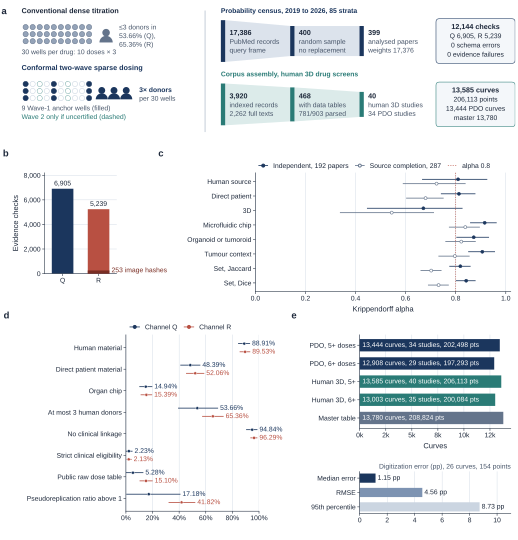
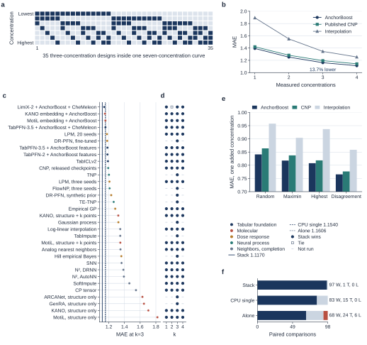
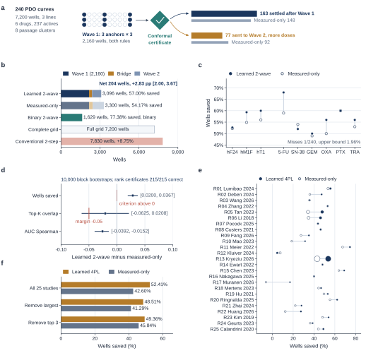
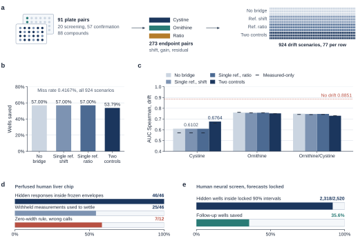
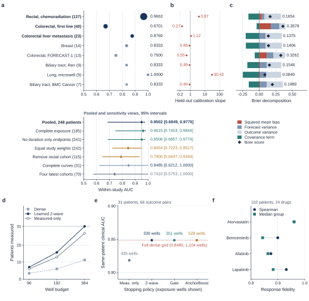

# Chip Forecast & AnchorBoost

**Measure three concentrations. Reconstruct the curve. Plan the next well.** Chip Forecast turns sparse organ chip and patient organoid measurements into response curves, uncertainty intervals and an actionable plate plan on a laptop CPU.

**56.8% fewer neural screening wells. 57.00% fewer human 3D PDO wells. 97 wins, 1 tie and 0 losses against 32 published predictor configurations.**

[Open the live workbench](https://yansu.me/chip-forecast/) · [Explore the four axes](workbench/audits/index.html) · [Read the technical report](technical_report.md) · [Public code](https://github.com/logxio/ooc-evaluation-audit)

**Author:** Yan Su (Tsinghua University · `hi@yansu.me` · [Interactive Workbench](https://yansu.me/chip-forecast/))

<p align="center">
  
</p>

> **Figure 1 | Probability census of 17,386 PubMed records and 40-study human 3D drug-response corpus.** **(a)** Conventional dense titration (30 wells per drug across $\le 3$ donors in 53.66% to 65.36% of studies) versus conformal two-wave sparse dosing (9 Wave-1 anchor wells, $3\times$ donor coverage per 30 wells), alongside the 399-paper stratified random probability census (12,144 quote and image-hash checks, 0 schema or evidence failures) and the 40-study human 3D corpus (13,585 curves, 206,113 points). **(b, c)** Independent six-axis coding reliability across 192 pre-sharing and 287 completed papers ($\alpha = 0.8054$ to $1.0000$ across all 12 fields after evidence reconciliation). **(d)** Weighted field prevalence showing 94.84% to 96.29% of eligible studies lack clinical outcome linkage. **(e)** Frozen human 3D and patient-derived organoid corpus scale and blinded digitization accuracy (median error 1.15 percentage points).

## 1. System Architecture & Main Vector Plates: From Three Concentrations to Clinical Cohort Allocation

AnchorBoost learns the residual around a log-concentration interpolation skeleton. Training enumerates every sparse design within complete training curves, including all $\binom{7}{3}=35$ three-concentration layouts. Chemical identities stay strictly separated across training, calibration and evaluation. Cross-forecaster disagreement selects the next concentration, and split-conformal risk control governs when to issue an activity call immediately, measure one additional concentration, or complete the series.

<p align="center">
  
</p>

> **Figure 2 | Exhaustive sparse-design residual learning defeats 32 published predictor configurations across 98 paired evaluations.** **(a)** All $\binom{7}{3}=35$ three-concentration sparse designs inside a seven-concentration curve. **(b)** Reconstruction MAE across $k=1$ to $4$ measured concentrations (13.7% lower error than interpolation at $k=3$). **(c, d)** Head-to-head benchmark across 32 published configurations (LimiX-2, TabPFN-3.5, TabICLv2, KANO, MotiL, CNP, TNP, FlowNP, DR-PFN, GP, GenRA): AnchorBoost Stack achieves **97 wins, 1 tie and 0 losses** across 98 paired comparisons (32/32 wins at $k=3$, MAE 1.1170; single CPU model 83W 15T 0L, MAE 1.1540). **(e, f)** Disagreement-guided 4th-concentration acquisition and aggregate paired win tallies.

<p align="center">
  
</p>

> **Figure 3 | Prelocked two-wave conformal stopping saves 57.00% of human organoid wells and generalizes across 25 held-out 3D studies.** **(a, b)** On 240 ten-concentration human pancreatic PDO curves (7,200 wells), prelocked two-wave stopping settles 163 curves after Wave 1 and consumes 3,096 total wells (**57.00% well saving** [54.00%, 60.00%], 204 fewer wells and +2.83 pp over measured-only stopping, 1/240 missed active). **(c, d)** Savings across organoid lines and drugs with 10,000-draw block-bootstrap intervals and 215/215 valid rank certificates. **(e, f)** Leave-one-study-out generalization across 25 human 3D studies (13,510 curves, 204,371 wells; 52.41% total wells saved).

<p align="center">
  
</p>

> **Figure 4 | Physical cross-plate drift invariance and blinded microfluidic organ-chip validation.** **(a-c)** Across 91 physical plate pairs (273 endpoint pairs, 924 drift scenarios), well savings remain invariant at **57.00%** (miss rate 0.4167%) while two-control affine bridging restores potency ranking. **(d)** Custodian-blinded perfused human liver chip: **46/46** withheld responses fall inside frozen 90% envelopes, settling all 12 curves in 25/46 measurements with **0 early errors** (versus 7/12 errors under a zero-width rule). **(e)** Prelocked human neural screen: **92.0%** (2,318/2,520) hidden wells inside locked 90% intervals with **35.6%** follow-up well savings.

<p align="center">
  
</p>

> **Figure 5 | Clinical responder prediction across 248 matched cancer patients and fixed-budget donor reallocation.** **(a-c)** Within-study clinical responder AUC reaches **0.9502** [0.6849, 0.9775] across 248 matched patients in 8 clinical study clusters (**0.9615** across 185 complete-exposure patients), whereas uncalibrated cross-study probability slopes span 0.27 to 30.42. **(d-f)** Reallocating saved wells from 30 to 9 wells per donor across 10,000 Monte Carlo arrival orders raises clinical responder AUC from 0.5033, 0.5111 and 0.5425 (dense) to **0.5155, 0.5870 and 0.8485** at 96, 192 and 384 wells, while preserving drug-response rankings across a 102-patient colorectal biobank.


## 2. Four-Axis Benchmark Scoreboard

Results below use the released evaluation sets and their stated denominators, dated 25 October 2026.

| Axis | Benchmark | Result | Evidence |
| :--- | :--- | :--- | :--- |
| A. Sparse acquisition | EPA neural chip screening | **56.8% well saving**, 12,119 of 28,080 exposure wells. 925 reported calls, 69 wrong. | [Technical report](technical_report.md) |
| A. Predictor comparison | 32 published predictor configurations, k=1 to 4 | AnchorBoost Stack **97W 1T 0L** across 98 paired comparisons. At k=3: **32/32 wins**, MAE **1.1170**. CPU single model: **83W 15T 0L**, MAE **1.1540**. | [Full scoreboard](results/final/baselines/scoreboard.csv) |
| A. Human 3D PDO | JCI, 240 curves, 10 concentrations, 7,200 wells | MODEL uses 3,096 wells, **57.00% saving [54.00%, 60.00%]**, mean 1.32 waves, 1/240 missed. Measured only uses 3,300 wells, 54.17% saving. MODEL saves **204 additional wells**, **+2.83 percentage points [2.00, 3.67]**. | [Acquisition receipt](workbench/audits/axis_a_v3_s56/public_readout.md) |
| A. Physical plate drift | 273 ToxCast physical drift pairs, 91 sample plate pairs, 88 compounds, 924 scenarios | **57.00% well saving** and **1/240 missed** across the evaluated drift scenarios. | [Drift results](workbench/audits/axis_a_v3_s56/artifacts/final_v3_jci_drift_sensitivity.json) |
| A. Perfused human liver | Bircsak, 46 hidden responses | **46/46** responses fall inside the locked envelopes. Sequential replay settles all curves with **25 points**, 0 early errors. | [Technical report](technical_report.md) |
| A. Human neural screen | Harrill, 2,520 hidden wells | **92.0%** interval coverage (2,318/2,520), **35.6%** next action well saving. | [Technical report](technical_report.md) |
| B. Patient PDO corpus | At least 5 positive concentrations | **34 strict direct patient PDO studies**, **13,444 curves**, **202,498 measured points**. | [Corpus readout](workbench/audits/corpus/public_s18/readout_s18.md) |
| B. Human 3D corpus | Qualified PDO and human 3D chip studies | **40 studies**, **13,585 curves**, **206,113 points**. Full master table: **13,780 curves**, **208,824 points**. | [Corpus readout](workbench/audits/corpus/public_s18/readout_s18.md) |
| C. Clinical linkage | 8 study clusters, 248 matched cancer patients, 243 with numerical sensitivity | Within study weighted AUC **0.9502 [0.6849, 0.9775]**. Complete exposure analysis: **185 patients**, 5 clusters, AUC **0.9615 [0.7453, 0.9844]**. LOSO calibration slopes: **0.27 to 30.42**. | [Clinical readout](workbench/audits/clinical_match_s54/protocol_s55/readout_s56.md) |
| C. Donor reallocation | 10,000 paired Monte Carlo draws in the nonsaturated study cohort | Reallocate **30 to 9 wells per donor**. Clinical responder AUC increases **+0.0286 / +0.0577 / +0.0994** at **96 / 192 / 384 wells**. At 96 wells, the 3 well design gives **+0.1605**. | [Budget results](workbench/audits/clinical_match_s54/protocol_s55/j2_budget_monte_carlo.json) |
| D. Literature survey | 17,386 PubMed records, 2019 to 2026, 85 strata | **399 stratified random sampled papers**, **12,144 quotation and image hash evidence checks**. Evidence aligned coding across 12 fields: Krippendorff alpha **0.8054 to 1.0000**. | [Survey readout](workbench/audits/survey400_s54/public_s58/readout_s58_full400.md) |
| D. Experimental design landscape | Weighted prevalence across the two coding channels | **94.84% to 96.29%** of eligible studies lack clinical outcome linkage. **53.66% to 65.36%** use at most 3 independent human donors. **5.28% to 15.10%** publish raw multidose tables. | [Survey statistics](workbench/audits/survey400_s54/public_s58/sample400_agreement_v2.json) |


## 3. Head-to-Head Benchmark Against 32 Published Models

MAE uses the released normalized response units at three measured concentrations. Lower values indicate closer reconstruction. The paired evaluation groups chemicals by parent identity. W, T and L count paired 95% interval outcomes across the available k=1 to 4 cells.

| Predictor | k=3 MAE | Paired record across 32 configurations |
| :--- | ---: | :--- |
| **AnchorBoost Stack** | **1.1170** | **97W 1T 0L** |
| **AnchorBoost Single CPU Model** | **1.1540** | **83W 15T 0L** |

| Published predictor configuration | k=3 MAE |
| :--- | ---: |
| LimiX-2 + AnchorBoost + CheMeleon | 1.1424 |
| KANO (embedding added to AnchorBoost) | 1.1515 |
| MotiL (embedding added to AnchorBoost) | 1.1564 |
| TabPFN-3.5 + AnchorBoost + CheMeleon | 1.1569 |
| LPM (20 seeds) | 1.1759 |
| DR-PFN (fine-tuned) | 1.1795 |
| TabPFN-3.5 + AnchorBoost features | 1.1824 |
| TabPFN-2 + AnchorBoost features | 1.1825 |
| TabICLv2 | 1.1893 |
| Conditional Neural Process CNP (released checkpoints) | 1.1920 |
| TNP | 1.2013 |
| LPM (three seeds) | 1.2083 |
| FlowNP (three seeds) | 1.2098 |
| DR-PFN (synthetic prior) | 1.2307 |
| TE-TNP | 1.2624 |
| Empirical GP | 1.2814 |
| KANO (structure + k points) | 1.3208 |
| Gaussian process | 1.3224 |
| Log-linear interpolation | 1.3453 |
| TabImpute | 1.3454 |
| MotiL (structure + k points) | 1.3465 |
| Analog nearest neighbors | 1.3491 |
| Hill empirical Bayes | 1.3603 |
| SNN | 1.3625 |
| N2 (DRNN) | 1.3867 |
| N2 (AutoNN) | 1.3922 |
| SoftImpute | 1.4620 |
| CP tensor | 1.5463 |
| ARCANet (structure only) | 1.6286 |
| GenRA (structure only) | 1.6484 |
| KANO (structure only) | 1.7046 |
| MotiL (structure only) | 1.8201 |

The table contains all 32 evaluated opponent configurations. The full [scoreboard](results/final/baselines/scoreboard.csv) includes each paired interval, chemical denominator and available concentration count. Gaussian process, Hill and released CNP checkpoint comparisons use their shared 193 chemical subset. The other rows use the 194 chemical cohort. The [technical report](technical_report.md) describes training, calibration and method sources.

## 4. Repository Module Structure

| Module | Responsibility | Entry point |
| :--- | :--- | :--- |
| [three_point.py](three_point.py) | CSV intake, curve reconstruction, 90% intervals, next concentration selection and locked forecast reconciliation. | `python three_point.py my_plates.csv` |
| [chip_release.py](chip_release.py) | Apply the calibrated paired readout rule and export patient screening actions. | `python chip_release.py --help` |
| [workbench/index.html](workbench/index.html) | Browser workbench with multichannel curves, plate layouts, chemical search, patient outcome reveal and CSV actions. | Open the HTML file. |
| [workbench/audits/index.html](workbench/audits/index.html) | Four axis evidence and 13 study examples with worksheet loading. | Open the audit page. |
| [workbench/audits/axis_a_v3_s56/](workbench/audits/axis_a_v3_s56/) | Human PDO acquisition, paired bootstrap and physical drift results. | `verify_receipt.py` |
| [workbench/audits/corpus/public_s18/](workbench/audits/corpus/public_s18/) | Portable human 3D curve table, study provenance and scope counts. | `verify_final_s18.py` |
| [workbench/audits/clinical_match_s54/protocol_s55/](workbench/audits/clinical_match_s54/protocol_s55/) | Matched clinical cohort, LOSO predictions and fixed budget simulation tables. | `readout_s56.md` and three JSON result files. |
| [workbench/audits/survey400_s54/public_s58/](workbench/audits/survey400_s54/public_s58/) | Stratified literature frame, evidence aligned coding and prevalence statistics. | `sample400_agreement_v2.json` |
| [technical_report.md](technical_report.md) | Method, benchmark definitions, source attribution and reproduction details. | Read the report. |

## 5. Quickstart

Open the [interactive browser workbench](https://yansu.me/chip-forecast/) (or local `workbench/index.html`) to inspect 68-channel concentration-response curves with 90% prediction intervals, toggle 48-well plate layouts, export next-step measurement actions, or drag and drop custom CSV plate readouts.

```sh
open workbench/index.html
```

For the Python workflow, install the released dependencies and provide a long CSV with columns `compound,concentration,unit,endpoint,value,plate,date`. Complete curves supply training and calibration. Three observed concentrations, including the highest, seed each incomplete test curve. An empty `value` marks a concentration to forecast.

```sh
python -m venv .venv
. .venv/bin/activate
python -m pip install -r requirements.txt
python three_point.py --help
python three_point.py my_plates.csv --out results/my_plates --jobs 1
```

The output directory contains `forecast.csv`, `summary.md`, fitted endpoint models and `lock.json`. Read `next_step` for the plate action. Add the requested concentration and run the same command with its measured value. Reconcile the finished measurements against the saved forecast:

```sh
python three_point.py my_finished_plates.csv --reconcile results/my_plates
```

## 6. Reproducibility & Verification

Run from the repository root with Python 3 and Node.js after installing the released dependencies. The four portable audits read only their distributed inputs and print a JSON receipt with `status` set to `passed`.

```sh
python workbench/audits/axis_a_v3_s56/verify_receipt.py
python workbench/audits/corpus/public_s18/verify_final_s18.py
python verify_s57.py
python workbench/audits/survey400_s54/public_s58/verify_survey.py
python workbench/verify.py --out /tmp/chip-forecast-verification
```

A recomputes acquisition totals, ranking metrics, 10,000 paired bootstrap draws and 924 drift scenario summaries. B recomputes all four corpus scope cells, the 40 study rows and resolved donor groups from the compressed curve table. C recomputes both clinical AUC estimates and their 10,000 draw bootstrap intervals, verifies LOSO study separation and the Brier decomposition, and reaggregates the released Monte Carlo summaries. D recomputes all 36 agreement estimates and their bootstrap intervals, plus 28 channel specific Horvitz Thompson estimates and intervals. The workbench check compares browser calculations with the Python screening commands.
